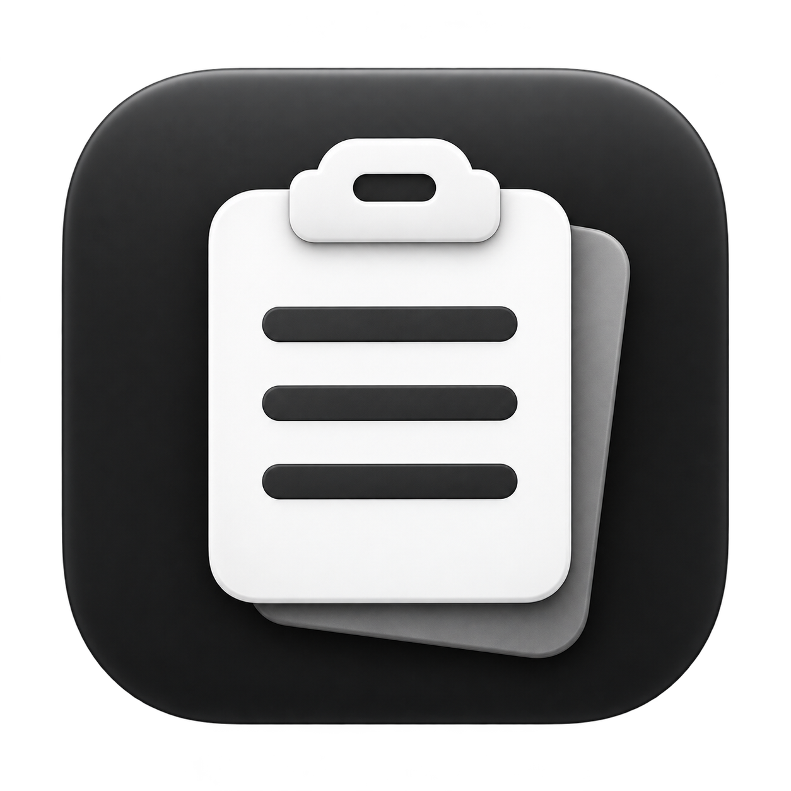

# Cliply

Нативная история текстового буфера обмена для **macOS 14 Sonoma и новее**, Intel и Apple Silicon. **Для запуска готового приложения Xcode не нужен.** Разрабатывать исходники можно на Windows; собирать их — на Mac с Xcode 15+ или автоматически в GitHub Actions.

## Скачать и запустить

Нажмите кнопку выше → откройте `Cliply.dmg` → перетащите **Cliply** в **Applications** → запустите приложение из «Программ». Значок появится в строке меню. Для автоматической вставки разрешите Accessibility в настройках Cliply.

## Использование

- Копируйте текст в любом приложении. Cliply хранит последние **10 уникальных записей**, новые сверху. Повторное копирование переносит прежнюю запись наверх; 11-я новая запись вытесняет старейшую.
- **⌘⇧V** открывает и закрывает историю рядом с указателем мыши. Панель выбирает монитор под указателем и остаётся внутри его `visibleFrame`, учитывая Dock и Menu Bar. Координаты используются в points, без ручного пересчёта Retina.
- Сразу вводите запрос для поиска. **↑ / ↓** выбирают запись, **Return** или клик вставляют её, **Escape** и клик снаружи закрывают панель. **⌘A** выделяет поисковый запрос.
- Левый клик по значку открывает историю; **правый клик** открывает меню с историей, настройками, очисткой, Launch at Login и выходом. Кнопка шестерёнки также открывает настройки.
- В Settings → Keyboard можно записать новое сочетание и восстановить стандартное. Поддерживаются Command, Shift, Option и Control. Требуется хотя бы Command, Option или Control с обычной клавишей. Конфликт регистрации отображается в настройках, прежняя рабочая комбинация сохраняется.
- Закрытие панели или настроек оставляет приложение работающим. Для завершения выберите **Quit Cliply** в меню значка.

## Язык и оформление

В **Settings → General → Interface** / **Настройки → Основные → Интерфейс** доступны:

- **Язык:** системный, **Русский**, **English**. В системном режиме выбирается русский или английский из предпочтений macOS; для других языков используется английский.
- **Оформление:** системное, **светлое**, **тёмное**. Системный режим автоматически следует текущей теме macOS; выбранная вручную тема применяется только к Cliply.

Изменения действуют сразу, без перезапуска: переводятся панель истории, настройки, Menu Bar, подсказки, сообщения об ошибках и подписи универсального доступа. Тема применяется к SwiftUI и нативным элементам AppKit, включая фон панели и заголовок окна. Поисковый запрос, выделение и содержимое записей при переключении сохраняются. Язык и оформление восстанавливаются после перезапуска приложения.

Иконка Cliply — белый буфер обмена на графитовой скруглённой плитке. Полный набор из 10 PNG для обычных и Retina-дисплеев включён в `Cliply/Resources/Assets.xcassets/AppIcon.appiconset/`; Xcode собирает из него нативный ресурс `AppIcon.icns`. В Finder, Applications и внутри DMG приложение отображается с этой иконкой. Menu Bar использует отдельный монохромный template-символ для читаемости на системном фоне. [Исходник и промпт иконки](Branding/ICON_BRIEF.md).

## Разрешения и автоматическая вставка

Чтобы вставить запись **сразу по Enter**, сначала установите текстовый курсор в нужную строку браузера, редактора или мессенджера. Нажмите **⌘⇧V**, выберите запись стрелками **↑ / ↓** и нажмите **Enter**. Cliply закроет историю, вернёт фокус в исходное приложение и отправит ему ⌘V. Обычный клик по записи также сразу запускает вставку — дополнительный Enter после клика не требуется.

Один раз разрешите автоматическую вставку: в истории нажмите **«Включить автовставку» / Enable automatic paste**, затем включите **Cliply** в открывшемся разделе разрешений macOS. После этого вернитесь в своё поле ввода и снова откройте историю. Пока Accessibility не разрешён, подсказка у Enter показывает «Копировать», а выбранный текст готовится для ручного ⌘V. После выдачи разрешения при следующем открытии истории подпись меняется на «Вставить».

В **Settings → Privacy → Request Permission** запросите разрешение, затем разрешите Cliply в **System Settings → Privacy & Security → Accessibility**. Кнопка Open System Settings открывает соответствующий раздел. Запрос выполняется по действию пользователя; сбор истории, поиск и Carbon hotkey работают без этого разрешения.

Cliply запоминает активное приложение и, если оно доступно через Accessibility, исходный элемент фокуса **до** показа панели. При выборе записи приложение:

1. Записывает исходный текст записи в `NSPasteboard`, сохраняя резервную копию прежних представлений в RAM на случай ошибки записи.
2. Закрывает панель и активирует сохранённое приложение.
3. Ограниченно ждёт подтверждения foreground PID и отпускания физических модификаторов. Проверки выполняются каждые 20 мс, максимум 1 секунду; одной фиксированной задержкой восстановление фокуса не определяется.
4. Проверяет, что выбранный текст ещё находится в буфере, по возможности восстанавливает AX-фокус и ещё раз проверяет целевой процесс и разрешение. Новое внешнее копирование во время ожидания отменяет автоматическую вставку и сохраняется.
5. Отправляет одну пару событий нажатия/отпускания **⌘V** через `CGEvent.postToPid` непосредственно сохранённому PID.

Если разрешение отсутствует, активен Secure Event Input, приложение завершилось или фокус восстановить не удалось, автоматическая вставка не отправляется. Выбранный текст остаётся в системном буфере, а ненавязчивая панель сообщает о ручной вставке **⌘V** и предлагает настройки. Она не активирует Cliply и не забирает фокус у исходного приложения.

CGEvent не предоставляет подтверждения, что конкретное приложение приняло и вставило текст. Некоторые приложения или защищённые поля могут игнорировать событие даже при доступных разрешениях. В таком случае текст остаётся готовым для ручной вставки; повторных автоматических попыток нет.

Для стабильных разрешений и автозапуска используйте одну установленную копию `Cliply.app`, например в `/Applications`, с постоянным bundle ID и подписью. После замены подписи macOS может потребовать заново выдать Accessibility. Для запуска скачанного приложения без блокировки Gatekeeper настройте Developer ID и нотариализацию по [инструкции выпуска](docs/DISTRIBUTION.md). Обычный CI-артефакт `Cliply-macOS-universal.zip` предназначен для тестирования; DMG в Releases подписывается и нотариализуется, если добавлены соответствующие secrets.

